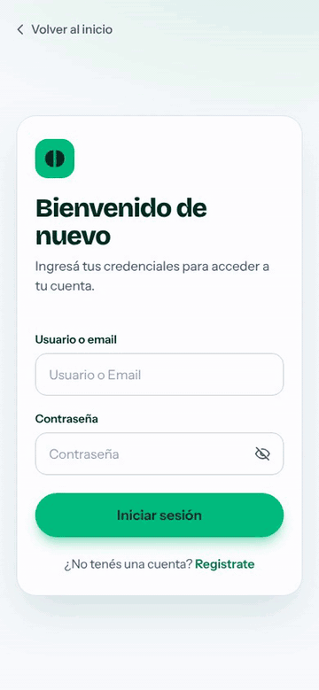
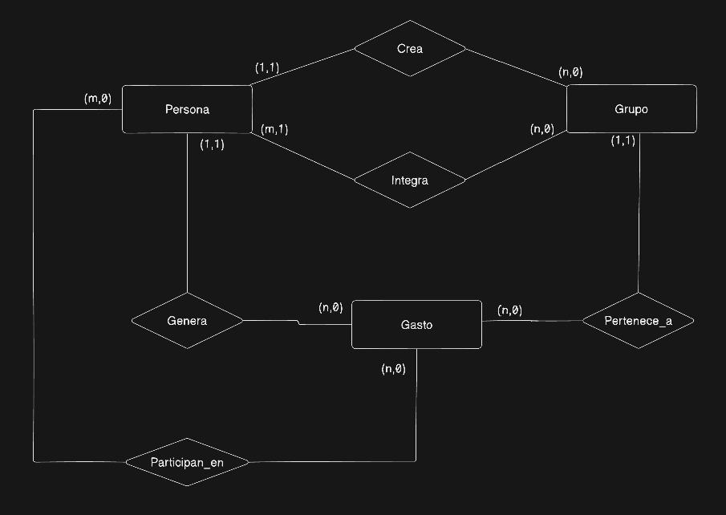
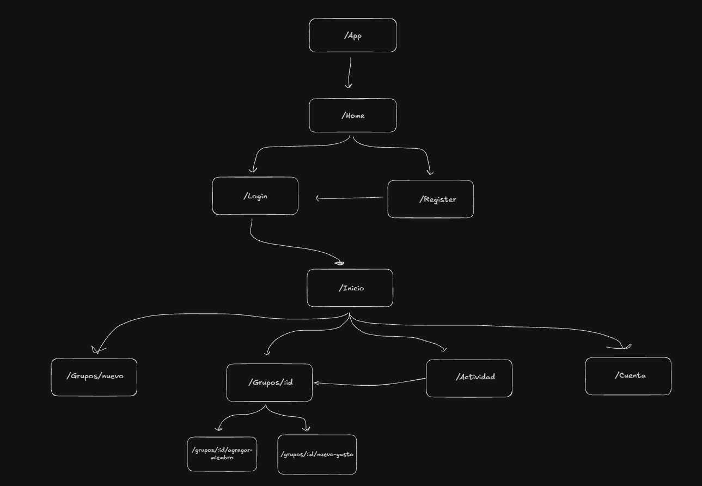

# Splitear

App web con diseño mobile-first para dividir gastos entre amigos: cargás los gastos de un grupo y la app calcula quién le debe a quién y propone los pagos para dejar todo en cero.

Fue originalmente pensado como una posible feature para billeteras virtuales como MODO o Mercado Pago. Que el cálculo de quién le debe a quién termine en transferencias directas entre los integrantes del grupo y no tener que salir del ecosistema de la aplicación. 


 

## Índice

- [Descripción](#descripción)
- [Uso de IA en el proyecto](#uso-de-ia-en-el-proyecto)
- [Funcionalidades](#funcionalidades)
- [Stack tecnológico](#stack-tecnológico)
- [Arquitectura](#arquitectura)
- [Modelo de datos (DER)](#modelo-de-datos-der)
- [Flujo de pantallas (frontend)](#flujo-de-pantallas-frontend)
- [Documentación de la API](#documentación-de-la-api)
- [Decisiones de diseño](#decisiones-de-diseño)
- [Requisitos previos](#requisitos-previos)
- [Instalación y ejecución](#instalación-y-ejecución)
- [Variables de entorno](#variables-de-entorno)
- [Tests](#tests)
- [Limitaciones conocidas](#limitaciones-conocidas)
- [Roadmap](#roadmap)
- [Autor](#autor)

## Descripción

En una salida, un viaje o un departamento compartido, alguien paga y los demás quedan debiendo. Splitear resuelve ese cuadre: cada grupo tiene integrantes, cada gasto se reparte entre los que participaron y, con los saldos de todos, la app arma una lista corta de pagos ("Nico le paga $3.000 a Cabe") que deja las cuentas en cero.

El proyecto cubre el ciclo completo hasta la liquidación: registro, grupos, gastos, saldos, actividad y perfil. Los pagos todavía no se registran dentro de la app (ver [Roadmap](#roadmap)).

## Uso de IA en el proyecto

El backend, el modelo de datos, el algoritmo de liquidación y la lógica de negocio los diseñé y escribí yo. La capa visual del front (Tailwind) se generó con Claude a partir de los esqueletos y la lógica de cada pantalla que armé yo. También usé Claude como apoyo para revisar código (consultas de Sequelize, estados de React) y para redactar este README.

## Funcionalidades

- Registro e inicio de sesión con usuario o email. La sesión vive en una cookie `httpOnly`.
- Grupos: creación con nombre, descripción, fecha de fin e integrantes por email. Quien lo crea es el administrador del grupo.
- Agregar integrantes a un grupo existente.
- Carga de gastos eligiendo entre quiénes se reparten. El reparto es equitativo y exacto al centavo.
- Pantalla de inicio con el saldo de cada grupo y el resumen de cuánto te deben y cuánto debés.
- Detalle de grupo con tres pestañas: gastos, saldos (quién puso de más y qué pagos dejan todo en cero) e integrantes (con botón para copiar el alias).
- Actividad: los últimos 30 gastos de todos tus grupos, agrupados por día, con el reparto desplegable.
- Perfil. Se facilita un registro rapido, luego el nombre y apellido se pueden modificar una sola vez. alias es modificable.
- Interfaz pensada para celular (mobile-first).
- La API también permite eliminar grupos, integrantes y gastos (soft delete), aunque todavía sin pantalla en el front.

## Stack tecnológico

| Capa | Tecnología |
|------|------------|
| Backend | Node.js, Express 5, Sequelize 6 |
| Base de datos | PostgreSQL (driver `pg` 8) |
| Autenticación | JWT (`jsonwebtoken` 9) en cookie `httpOnly`, contraseñas con `bcrypt` 6 |
| Frontend | React 19, Vite 8, React Router 7, Axios |
| Estilos | Tailwind CSS 4 |
| Herramientas | nodemon, ESLint 10 |

## Arquitectura

El back separa cada pedido en capas, de afuera hacia adentro:

```
request → routes → middlewares → controllers → services → models → PostgreSQL
```

- **routes:** declaran la URL y qué middlewares pasan antes del controller.
- **middlewares:** autenticación por cookie, pertenencia al grupo, permiso de administrador y manejo de errores.
- **controllers:** leen el request y arman la respuesta HTTP.
- **services:** contienen la lógica de negocio y las consultas (reparto, saldos, liquidación). Se reutilizan entre controllers, por ejemplo `listadoGruposUsuario` alimenta tanto el inicio como la actividad.
- **models:** definición de tablas y asociaciones con Sequelize.

La razón de separar controllers de services es poder probar y reutilizar la lógica sin pasar por HTTP.

```
Splitear/
├── splitear-back/
│   ├── docs/
│   │   └── algoritmo.md            # Diseño del algoritmo de liquidación
│   └── src/
│       ├── index.js                # Arranque: carga .env, sincroniza la BD y levanta el servidor
│       ├── app.js                  # Express: JSON, cookies, CORS y montaje de rutas
│       ├── db.js                   # Conexión de Sequelize a PostgreSQL
│       ├── routes/                 # auth, usuarios, grupos y gastos
│       ├── controllers/            # Capa HTTP
│       ├── services/               # Lógica de negocio y consultas
│       ├── middlewares/            # auth.middlewares.js y error.middleware.js
│       └── models/                 # User, Grupo, Pertenencia, Gasto, Detalle_gasto + asociaciones (index.js)
└── splitear-front/
    └── src/
        ├── main.jsx                # Entrada: AuthProvider y BrowserRouter
        ├── App.jsx                 # Tabla de rutas
        ├── pages/                  # Una por pantalla
        ├── components/             # Encabezado, BarraNav, Logout, RutaProtegida, SoloInvitados
        ├── context/AuthContext.jsx # Sesión del usuario (consulta /auth/me al cargar)
        └── services/api.js         # Instancia de Axios (baseURL y cookies)
```

## Modelo de datos (DER)




- **USER:** persona registrada. `username` e `email` son únicos. La contraseña se guarda hasheada con su `salt`.
- **GRUPO:** conjunto de personas que comparten gastos. `creadorId` es el administrador.
- **PERTENENCIA:** tabla intermedia entre usuarios y grupos (relación muchos a muchos).
- **GASTO:** un pago hecho por un usuario (`idCreadorGasto`) dentro de un grupo, por un monto total.
- **DETALLE_GASTO:** la parte de ese gasto que le toca a cada participante. La suma de los detalles de un gasto es su monto. El par (`idGasto`, `idParticipante`) es único.

**Soft delete:** `GRUPO`, `PERTENENCIA`, `GASTO` y `DETALLE_GASTO` usan `paranoid` de Sequelize pensado para posibles auditorías. Un `destroy` completa `deletedAt` y las consultas posteriores ignoran esa fila. `USER` no se borra.

## Flujo de pantallas (frontend)



Desde cualquier pantalla principal, la barra inferior lleva a Grupos (`/inicio`), Actividad y Perfil.

| Ruta | Pantalla | Acceso |
|------|----------|--------|
| `/` | Home (presentación) | Solo invitados |
| `/login` | Login | Solo invitados |
| `/register` | Registro | Solo invitados |
| `/inicio` | Mis grupos | Protegida |
| `/grupos/nuevo` | Nuevo grupo | Protegida |
| `/grupos/:id` | Detalle del grupo | Protegida |
| `/grupos/:id/nuevo-gasto` | Nuevo gasto | Protegida |
| `/grupos/:id/agregar-miembro` | Agregar integrante | Protegida |
| `/actividad` | Actividad | Protegida |
| `/perfil` | Mi cuenta | Protegida |
| `*` | 404 | Pública |

"Solo invitados" redirige a `/inicio` si ya hay sesión. "Protegida" redirige a `/login` si no la hay. Las dos reglas viven en `SoloInvitados.jsx` y `RutaProtegida.jsx`.

## Documentación de la API

**Convenciones**

- URL base: `http://localhost:3000`. Cuerpo y respuestas en JSON.
- **Autenticación:** el login deja una cookie `token` (JWT, `httpOnly`, 2 horas de vida). El front envía las cookies con `withCredentials`. Sin cookie válida, las rutas protegidas responden `401` sin cuerpo.
- **Errores:** JSON con un texto en `message` (algunos endpoints más viejos usan `mensaje` o `error`).
- **Acceso:** `pública`, `logueado`, `miembro` (pertenece al grupo) o `admin` (creador del grupo).

### Auth

| Método | Ruta | Acceso | Descripción |
|--------|------|--------|-------------|
| POST | `/auth/register` | pública | Crea la cuenta. Body: `email`, `username`, `password`. Devuelve el usuario sin `password` ni `salt`. |
| POST | `/auth/login` | pública | Body: `identificador` (usuario o email) y `password`. Setea la cookie y devuelve el usuario. |
| POST | `/auth/logout` | pública | Borra la cookie. Responde `204`. |
| GET | `/auth/me` | logueado | Devuelve el usuario de la sesión. El front lo consulta al cargar la app. |

### Usuarios

| Método | Ruta | Acceso | Descripción |
|--------|------|--------|-------------|
| GET | `/usuarios?q=` | logueado | Busca usuarios por nombre (hasta 20, sin incluirte). Sin `q` devuelve `[]`. Aún sin uso en el front. |
| GET | `/usuarios/:id` | logueado | Datos públicos de un usuario. Aún sin uso en el front. |
| PUT | `/usuarios/:id` | logueado | Actualiza `alias`, `name` y `last_name`. Siempre actúa sobre el usuario de la sesión. Nombre y apellido solo se pueden cargar si estaban vacíos. |

### Grupos

| Método | Ruta | Acceso | Descripción |
|--------|------|--------|-------------|
| POST | `/grupos` | logueado | Crea un grupo. Body: `nombreGrupo`, `descripcion?`, `fechaFin?`, `integrantes?` (emails). Quien lo crea queda como administrador e integrante. |
| GET | `/grupos` | logueado | Tus grupos, cada uno con su `saldoNeto` (lo que pusiste menos lo que consumiste). |
| GET | `/grupos/actividad` | logueado | Los últimos 30 gastos de todos tus grupos, con creador, grupo y reparto. |
| GET | `/grupos/:id` | miembro | Detalle: `grupo`, `integrantes`, `gastosPorIntegrante` y `gastoTotalGrupo`. |
| GET | `/grupos/:id/gastos` | miembro | Gastos del grupo, del más nuevo al más viejo, con su creador. |
| GET | `/grupos/:id/integrantes` | miembro | Integrantes del grupo. |
| POST | `/grupos/:id/miembros` | admin | Suma un integrante. Body: `{ integrante: { email } }`. |
| DELETE | `/grupos/:id` | admin | Elimina el grupo (soft delete). |
| DELETE | `/grupos/:id/miembros/:userId` | admin | Quita un integrante. El administrador no puede quitarse a sí mismo. |

### Gastos

| Método | Ruta | Acceso | Descripción |
|--------|------|--------|-------------|
| POST | `/gastos/:id` | miembro | Crea un gasto en el grupo `:id`. Body: `monto`, `descripcion?`, `participantes` (`[{ id }]`). Reparte en una transacción. |
| DELETE | `/gastos/:id/:idGasto` | miembro (autor del gasto o admin) | Elimina el gasto y su reparto (soft delete, en una transacción). `:id` es el grupo. |
| GET | `/gastos/grupos/:id/balance` | miembro | Liquidación del grupo: lista de `{ idA, idB, montoDeuda }`, donde `idA` le debe `montoDeuda` a `idB`. Es de solo lectura. |


**Códigos de error principales**

| Código | Cuándo |
|--------|--------|
| 400 | Datos inválidos: monto menor o igual a cero, formato de email, nombre de grupo repetido, intento de cambiar nombre o apellido ya cargados. |
| 401 | Sin cookie, token inválido o vencido, credenciales incorrectas. |
| 403 | No pertenecés al grupo, o la acción es solo del administrador. |
| 404 | Grupo, gasto o usuario inexistente (o ya eliminado). |
| 409 | Email o usuario ya registrado, o la persona ya está en el grupo. |
| 500 | Error inesperado. |

## Decisiones de diseño

**Reparto en centavos con resto exacto.** El monto se guarda como `DECIMAL(10,2)`, pero el reparto se calcula en centavos enteros: cada participante recibe la parte entera y los centavos que sobran se asignan de a uno. Así la suma de los detalles siempre da el monto del gasto. Descarté dividir con decimales y redondear, porque pierde o inventa centavos ($100 entre 3 daría $99,99).

**Liquidación por saldo neto.** Para cada integrante se calcula `saldo = lo que pagó − lo que consumió`. Los deudores (saldo negativo) y los acreedores (positivo) se ordenan y se cruzan con dos punteros, uno por cada extremo: el que más debe le paga al que más puso. Con eso se generan, como máximo, tantos pagos como integrantes menos uno. Descarté liquidar gasto por gasto o de a pares, que obliga a que todos se paguen entre todos. El razonamiento completo está en [`splitear-back/docs/algoritmo.md`](splitear-back/docs/algoritmo.md).

**Transacciones en operaciones compuestas.** Crear un gasto (gasto y detalles), crear un grupo (grupo e integrantes) y eliminar un gasto (detalles y gasto) se ejecutan en una transacción. Si falla un paso, no queda un gasto sin reparto ni un grupo a medio armar.

**Soft delete para auditoría.** Grupos, pertenencias, gastos y detalles se marcan como eliminados en lugar de borrarse. El historial se conserva y Sequelize excluye lo eliminado de las sumas de saldos sin código extra. El costo es que las tablas crecen y cualquier consulta SQL directa tiene que filtrar `deletedAt`.

**Autenticación con JWT en cookie `httpOnly`.** El token no es accesible desde JavaScript, lo que reduce el riesgo de robo por XSS. Descarté guardarlo en `localStorage` y mandarlo en un header, que es más simple pero deja el token expuesto a cualquier script de la página. En producción la cookie se marca `secure`.

**Administrador sin tabla de roles.** El administrador de un grupo es su creador (`creadorId`). Alcanza para el alcance actual (agregar y quitar integrantes, eliminar el grupo). Una columna de rol en `PERTENENCIA` sería el paso siguiente si hiciera falta más de un administrador.

**Manejo centralizado de errores.** `error.middleware.js` traduce los errores de Sequelize (unicidad a `409`, validación a `400`) y los errores con `statusCode` a respuestas JSON. Los controllers nuevos delegan con `next(error)`. Algunos controllers anteriores todavía responden por su cuenta (ver [Limitaciones](#limitaciones-conocidas)).

**Actividad en dos consultas.** El feed trae los 30 gastos más recientes y, aparte, sus detalles (`separate: true`). Con un solo `JOIN`, el `LIMIT` contaría filas del reparto y no gastos. Cada fila trae el reparto completo, así que el desplegable del front abre sin pedidos extra.

## Requisitos previos

- Node.js 20.19 o superior (lo exige Vite 8; el back corre desde Node 18)
- npm
- PostgreSQL, con una base de datos vacía creada para el proyecto

## Instalación y ejecución

### Backend

```bash
cd splitear-back
npm install
```

1. Creá la base de datos. Por ejemplo, con `psql`: `CREATE DATABASE splitear;`
2. Creá un archivo `.env` en `splitear-back/` con las variables de [esta sección](#variables-de-entorno).
3. Levantá el servidor:

```bash
npm run dev
```

La primera vez, el servidor crea las tablas automáticamente. Si todo salió bien, la consola muestra `Servidor escuchando en el puerto 3000 y DB conectada`.

### Frontend

En otra terminal:

```bash
cd splitear-front
npm install
npm run dev
```

Abrí `http://localhost:5173`. El front llama a `http://localhost:3000`, y el back solo acepta pedidos de `http://localhost:5173`. Ambas URLs están fijas en el código (`splitear-front/src/services/api.js` y `splitear-back/src/app.js`).

## Variables de entorno

Archivo `splitear-back/.env` (está en `.gitignore`; nunca subas valores reales).

| Variable | Descripción | Ejemplo |
|----------|-------------|---------|
| `PORT` | Puerto del servidor. El front espera el 3000. | `3000` |
| `DB_HOST` | Host de PostgreSQL. | `localhost` |
| `DB_NAME` | Nombre de la base de datos. | `splitear` |
| `DB_USER` | Usuario de PostgreSQL. | `postgres` |
| `DB_PASSWORD` | Contraseña de ese usuario. | `tu_contraseña` |
| `JWT_SECRET` | Clave para firmar los tokens. Usá una cadena larga y aleatoria. | `generala con el comando de abajo` |
| `NODE_ENV` | `development` o `production`. En `production` la cookie exige HTTPS. | `development` |

Para generar un `JWT_SECRET`:

```bash
node -e "console.log(require('crypto').randomBytes(48).toString('hex'))"
```

## Tests

Todavía no hay tests automatizados: `npm test` es el placeholder de npm. Los casos con más valor para cubrir primero son los de la lógica de dinero:

- Reparto: montos que no se dividen exacto entre los participantes (la suma de las cuotas debe dar el monto) y gastos con un solo participante.
- Liquidación: saldos que suman cero, grupos sin gastos, integrantes que no participaron y ciclos de deudas.

## Limitaciones conocidas

Son decisiones de alcance que quedaron pendientes a propósito:

- **`sync({ alter: true })` en lugar de migraciones.** Es cómodo mientras el modelo cambia. Para producción hacen falta migraciones.
- **Liquidación con números de punto flotante.** El reparto es exacto en centavos, pero los saldos se suman como `Number`. El front descarta restos menores a medio centavo. Lo correcto es liquidar también en centavos enteros.
- **N+1 en algunas consultas.** `POST /gastos` y `POST /grupos` validan participantes de a uno, y `GET /grupos` hace dos consultas por grupo para calcular el saldo.
- **Invitaciones por mail sin implementar.** Cuando el email no tiene cuenta, la API responde que se envió una invitación, pero `enviarMail` está vacía.
- **El balance es de solo lectura.** No se registran pagos, así que el saldo no baja cuando alguien paga.
- **Formato de errores no unificado.** Conviven `message`, `mensaje` y `error`. Falta pasar los controllers anteriores al middleware central.
- **Validación de entrada mínima en el back.** Reglas como "al menos un participante por gasto" hoy dependen del front.
- **Seguridad de la cookie.** No define `SameSite` ni hay protección anti-CSRF específica. El token dura 2 horas, sin renovación.
- **Eliminar grupo, integrante o gasto** existe en la API pero no tiene pantalla.
- **Actividad sin paginación:** muestra los últimos 30 gastos.
- **Sin tests ni deploy.** URLs de front, back y CORS fijas a `localhost`.

## Roadmap

- Integración con Mercado Pago vía OAuth para pagar las deudas sugeridas.
- Registrar pagos ("marcar como pagado") e incluirlos en la actividad.
- Invitaciones reales por email.
- Tests de reparto y liquidación.
- Migraciones, URLs por variables de entorno y deploy.
- Paginación de la actividad y pantallas para eliminar grupos, integrantes y gastos.
- Tema oscuro.

## Autor

**Fabrizio Bellinvia** · [GitHub](https://github.com/bellinviafab) · [Linkedin](https://www.linkedin.com/in/fabrizio-bellinvia-4a6a871b7/)

## Licencia

Pendiente de definir.